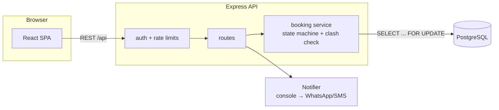

# Seva

**Trusted home help, booked in minutes.** Seva connects households with ID-verified domestic workers (cleaning, cooking, babysitting, elder care, laundry and gardening), starting in Agra.

Households can book a **one-time visit** or a **monthly hire** (a fixed daily time slot). The Seva team confirms every booking by phone with the worker. Workers are onboarded in person by an admin, because many don't use smartphone apps.


## Features

- **OTP login** by mobile number, with no passwords
- **Worker search** by service and locality, showing only verified and active workers
- **Booking**: one-time slots or recurring monthly hires, priced upfront, with live availability
- **Double-booking prevention**, guaranteed at the database level (see below)
- **Admin dashboard**: confirm/reject bookings, onboard and verify workers, and view 30-day stats
- **Audit trail** of every booking status change (who, when, why)
- **Encrypted government IDs**: only the type and last 4 digits are ever readable

## Tech stack

| Layer | Tech |
|---|---|
| Frontend | React 19, TypeScript, Vite, React Router, TanStack Query, Tailwind CSS v4 |
| Backend | Node.js, Express 5, TypeScript, Zod validation |
| Database | PostgreSQL 16, Drizzle ORM, SQL migrations |
| Auth | Phone OTP → JWT (HS256), role-based access (household / admin) |
| Testing | Vitest + Supertest integration tests against a real Postgres |
| DevOps | Docker Compose, GitHub Actions CI |

## Architecture



```
apps/
  api/
    src/
      db/schema.ts           Drizzle schema (users, workers, bookings, booking_events, otp_codes)
      services/bookings.ts   booking rules: validation, clash detection, pricing, state machine
      routes/                auth, workers, bookings, admin
      lib/crypto.ts          AES-256-GCM ID encryption, HMAC OTP hashing
    db/migrations/           SQL migrations (incl. exclusion constraint)
    test/                    49 unit + integration tests
  web/
    src/pages/               Home, Workers, WorkerDetail, Login, MyBookings, BookingDetail, admin/*
```

## Engineering decisions

**1. Preventing double-booking under concurrency.** Two households can hit "Book" for the same worker at the same moment. Seva uses two layers of protection:

- The booking transaction takes a **row lock on the worker** (`SELECT … FOR UPDATE`), so concurrent bookings for the same worker run one at a time, and the clash check always sees committed data.
- A **Postgres exclusion constraint** (`EXCLUDE USING gist (worker_id WITH =, tstzrange(start_at, end_at) WITH &&)`) makes overlapping one-time bookings impossible even if application code is bypassed.

A test fires 10 simultaneous requests for the same slot and asserts that exactly one succeeds.

**2. Monthly hires vs one-time visits.** A monthly hire is an open-ended daily window (e.g. 8–10 am from 5 Oct). It blocks any one-time booking that overlaps that window on or after its start date, and vice versa. Clash detection (`slotsClash`) is a pure function and is unit-tested separately.

**3. Time zones.** All timestamps are stored in UTC. The API accepts and returns IST dates and times (`"date": "2026-10-05", "startTime": "09:00"`), so clients never do time zone math. IST has no daylight saving, so conversion is plain arithmetic.

**4. OTP security.**

- Codes are stored as `HMAC-SHA256(phone:code)`, never in plain text, and compared in constant time.
- Each code is single-use (via a conditional `UPDATE … WHERE consumed_at IS NULL`), expires in 5 minutes and locks after 5 wrong attempts.
- Requests are rate-limited per phone (30 s cooldown, 5 per hour) and per IP.

**5. Worker ID data (DPDP-minded).** Aadhaar and other ID numbers are encrypted with **AES-256-GCM** (random IV, auth tag, versioned format for key rotation). The API only ever returns the ID type and last 4 digits. Workers can't be verified without an ID on file.

**6. Booking state machine.** Allowed transitions are declared in one table:

```
REQUESTED → CONFIRMED | REJECTED   (admin)
REQUESTED → CANCELLED              (household or admin)
CONFIRMED → COMPLETED              (admin, only after start time)
CONFIRMED → CANCELLED              (household before start, or admin)
```

Every transition writes a `booking_events` row inside the same transaction.

## Running locally

Prerequisites: Node 20+, Docker (or a local Postgres 16).

```bash
npm install
npm run db:up                       # starts Postgres on :5432 (creates seva and seva_test)
cp apps/api/.env.example apps/api/.env
# generate a key and paste it into ID_ENCRYPTION_KEY in apps/api/.env:
openssl rand -base64 32
npm run db:migrate
npm run db:seed                     # 9 demo workers in Agra + an admin account
npm run dev                         # API on :4000, web on :5173
```

Open http://localhost:5173. In dev mode, the OTP is shown on the login screen.

- **Household:** log in with any valid mobile number (e.g. `9876543210`)
- **Admin:** log in with `9999999999` (set via `ADMIN_PHONES`)

### Tests

```bash
npm test          # resets the seva_test database, runs migrations, runs all tests
npm run typecheck
```

## API overview

| Method | Path | Who |
|---|---|---|
| POST | `/api/auth/otp/request` · `/api/auth/otp/verify` | public |
| GET/PATCH | `/api/me` | logged in |
| GET | `/api/workers?service=&locality=&page=` | public |
| GET | `/api/workers/:id` · `/api/workers/:id/availability?date=` | public |
| POST | `/api/bookings` | household |
| GET | `/api/bookings?status=active\|past` · `/api/bookings/:id` | owner or admin |
| POST | `/api/bookings/:id/cancel` | owner or admin |
| GET/POST/PATCH | `/api/admin/workers` · `/api/admin/workers/:id/verify` | admin |
| GET | `/api/admin/bookings?status=` · `/api/admin/stats` | admin |
| POST | `/api/admin/bookings/:id/transition` | admin |

## Roadmap

- [ ] Razorpay booking fee (order → checkout → webhook signature verification)
- [ ] WhatsApp/SMS notifications (swap the `Notifier` implementation)
- [ ] Real-time booking status with Socket.io
- [ ] Deploy (API + Postgres on Render/Railway, web on Vercel)
- [ ] Load test booking endpoint with k6
- [ ] Hindi UI
- [ ] Worker ratings after completed bookings
